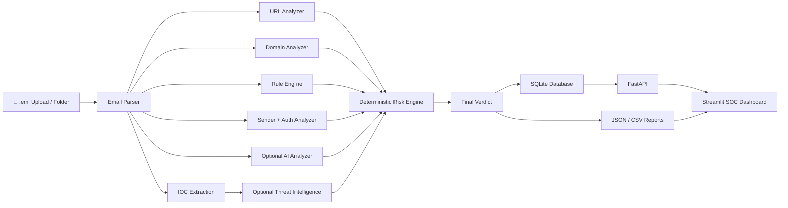

# 🛡️ AI Phishing Triage Bot

> **Triage 100+ phishing emails in minutes with deterministic, explainable risk scoring, IOC extraction, optional AI analysis, and a SOC-style investigation dashboard.**

The **AI Phishing Triage Bot** is a defensive cybersecurity tool designed for SOC analysts and security teams to rapidly analyze suspicious emails.

Drop in `.eml` files and the system automatically extracts indicators, analyzes phishing signals, calculates an explainable **0–100 risk score**, classifies the email as **BENIGN**, **SUSPICIOUS**, or **PHISHING**, and recommends appropriate SOC actions.

### 🔑 Core Design Principle

**The LLM never controls the final verdict.**

The final risk score and classification are determined by a **deterministic and auditable risk engine**. AI is optional and is used only as a bounded enrichment layer.

---

## 🚀 Features

### 📧 Email Analysis

- Robust `.eml` / MIME parsing
- Header normalization
- Plain-text and HTML extraction
- SPF/DKIM/DMARC result parsing
- Attachment metadata extraction
- Malformed email recovery
- Message and MIME-part size limits

### 🔗 URL Analysis

Static URL analysis without visiting or executing links.

Detects signals such as:

- IP-address URLs
- Userinfo obfuscation
- Look-alike URLs
- Anchor-text mismatches
- URL shorteners
- Suspicious TLDs
- Open-redirect parameters
- Encoded separators
- Executable downloads
- Suspicious URL structures

> ⚠️ **No suspicious URL is automatically visited.**

### 🌐 Domain Analysis

Detects common domain impersonation techniques:

- Typosquatting
- Leetspeak substitutions
- Brand impersonation
- Brand names inside suspicious subdomains
- Punycode
- Suspicious hyphen/digit patterns
- Look-alike domains

Example:

```text
paypa1-secure.example
micros0ft-login.example
paypla.example
```

Official-domain allow-lists are used to reduce false positives.

### 🧠 Phishing Detection Rules

The rule engine analyzes:

- Urgency
- Credential requests
- Account suspension threats
- Payment requests
- Invoice scams
- Gift-card scams
- Cryptocurrency lures
- CEO fraud
- Delivery scams
- Prize scams
- Dangerous attachments
- Embedded password forms
- Social-engineering language
- Prompt-injection attempts

### 👤 Sender Intelligence

Analyzes relationships between:

```text
From
Reply-To
Return-Path
Sender
Display Name
Authentication Results
```

Detects:

- Reply-To mismatches
- Return-Path anomalies
- Display-name spoofing
- Freemail corporate impersonation
- Suspicious sender domains
- SPF/DKIM/DMARC failures

### 📊 Explainable Risk Scoring

Every email receives:

- Risk score: **0–100**
- Classification
- Confidence
- Component scores
- Detection reasons
- Analyst notes
- Recommended actions

### 🤖 Optional AI Analysis

The AI layer provides:

- Additional explanation
- Investigation summary
- Risk context
- Recommended analyst actions

The AI is:

- Optional
- Provider-independent
- JSON-validated
- Prompt-injection aware
- Limited to a maximum contribution of **10/100 points**

AI cannot independently turn a clean email into a phishing verdict.

### 🌍 Optional Threat Intelligence

Optional integrations include:

- VirusTotal
- AbuseIPDB

Features include:

- Reputation lookups
- TTL caching
- Lookup budgets
- Graceful failure
- No fabricated intelligence

### 📦 Batch Triage

Analyze **100+ emails automatically**.

The batch processor provides:

- Per-email progress
- Per-file isolation
- Aggregate statistics
- JSON report
- CSV report
- Database persistence

A malformed email does not stop the entire batch.

### 🖥️ SOC Dashboard

The Streamlit dashboard provides:

- Classification statistics
- Risk distribution
- Suspicious-domain analysis
- Rule statistics
- Email explorer
- Investigation workspace
- IOC visualization
- AI analysis
- Threat-intelligence results
- CSV export

---

# 🏗️ Architecture



### Analysis Pipeline

```text
Email
  │
  ▼
Parsing
  │
  ▼
IOC Extraction
  │
  ▼
Static URL Analysis
  │
  ▼
Domain Analysis
  │
  ▼
Rule Detection
  │
  ▼
Sender & Authentication Analysis
  │
  ▼
Optional AI Enrichment
  │
  ▼
Deterministic Risk Engine
  │
  ▼
Final Verdict
  │
  ├──► BENIGN
  ├──► SUSPICIOUS
  └──► PHISHING
```

External services are optional and cannot block or replace the deterministic verdict.

---

# 🧰 Tech Stack

| Component | Technology |
|---|---|
| Language | Python 3.12+ |
| Email Parsing | Python `email` library |
| HTML Parsing | BeautifulSoup + lxml |
| API | FastAPI |
| Server | Uvicorn |
| Validation | Pydantic v2 |
| Configuration | pydantic-settings |
| Database | SQLAlchemy 2.0 |
| Default Database | SQLite |
| Production Database | PostgreSQL-ready |
| AI | OpenAI-compatible API |
| Threat Intelligence | VirusTotal / AbuseIPDB |
| Dashboard | Streamlit |
| Data Processing | pandas |
| HTTP Client | httpx |
| Testing | pytest |

---

# 📁 Project Structure

```text
ai-phishing-triage-bot/
│
├── app/
│   ├── __init__.py
│   ├── main.py
│   ├── config.py
│   ├── utils.py
│   │
│   ├── models/
│   │   ├── __init__.py
│   │   └── schemas.py
│   │
│   ├── email_parser/
│   │   ├── __init__.py
│   │   └── parser.py
│   │
│   ├── detection/
│   │   ├── ioc_extractor.py
│   │   ├── url_analyzer.py
│   │   ├── domain_analyzer.py
│   │   ├── sender_analyzer.py
│   │   ├── rules.py
│   │   └── risk_engine.py
│   │
│   ├── ai/
│   │   └── analyzer.py
│   │
│   ├── threat_intel/
│   │   └── reputation.py
│   │
│   ├── database/
│   │   ├── database.py
│   │   └── repository.py
│   │
│   ├── services/
│   │   └── triage_service.py
│   │
│   └── api/
│       └── routes.py
│
├── dashboard/
│   └── app.py
│
├── scripts/
│   ├── generate_samples.py
│   └── batch_triage.py
│
├── data/
│   ├── input/
│   └── output/
│
├── tests/
│   └── ...
│
├── .env.example
├── .gitignore
├── requirements.txt
├── run.py
└── README.md
```

---

# ⚡ Quick Start

## 1. Clone the repository

```bash
git clone https://github.com/YOUR_USERNAME/ai-phishing-triage-bot.git
cd ai-phishing-triage-bot
```

## 2. Create a virtual environment

### Windows PowerShell

```powershell
python -m venv .venv
.venv\Scripts\Activate.ps1
```

### Linux / macOS

```bash
python3 -m venv .venv
source .venv/bin/activate
```

## 3. Install dependencies

```bash
pip install -r requirements.txt
```

## 4. Configure environment variables

Copy:

```text
.env.example
```

to:

```text
.env
```

The application works without external API keys.

Optional integrations:

```env
OPENAI_API_KEY=
VIRUSTOTAL_API_KEY=
ABUSEIPDB_API_KEY=
```

> **Never commit `.env` to GitHub.**

---

# 🧪 Generate the Demo Dataset

Generate the safe synthetic email dataset:

```bash
python scripts/generate_samples.py
```

This creates fictional `.eml` files for testing.

The dataset contains:

- Benign emails
- Suspicious emails
- Phishing emails

No real malicious infrastructure is contacted.

---

# ▶️ Usage

## Analyze One Email

```bash
python run.py --file data/input/07_phishing_credential_paypal.eml --no-ai
```

Example:

```text
========================================
       AI PHISHING TRIAGE BOT
========================================

File: 07_phishing_credential_paypal.eml

Classification: PHISHING
Risk Score:     71/100
Confidence:     73%

Reasons:

- Suspicious sender domain
- Credential harvesting request
- Suspicious URL
- SPF/DKIM/DMARC failures
- Reply-To mismatch

Recommended Action:

QUARANTINE

========================================
```

---

# 📦 Batch Processing

Analyze an entire folder:

```bash
python scripts/batch_triage.py --input data/input --no-ai
```

Example:

```text
==========================================

Total: 100

Benign:      42
Suspicious:  21
Phishing:    37

High Risk:   35
Medium Risk: 18
Low Risk:    47

==========================================
```

Reports are generated as:

```text
data/output/results.json
data/output/results.csv
```

### Large Dataset

```bash
python scripts/batch_triage.py \
    --input maildrop \
    --recursive \
    --limit 250 \
    --no-ai \
    --no-db
```

---

# 🌐 FastAPI

Start the API:

```bash
uvicorn app.main:app --host 127.0.0.1 --port 8000
```

Open:

```text
http://127.0.0.1:8000/docs
```

### Available Endpoints

| Method | Endpoint | Purpose |
|---|---|---|
| GET | `/health` | Health check |
| POST | `/analyze/email` | Analyze `.eml` |
| POST | `/analyze/email/raw` | Analyze raw email |
| POST | `/analyze/batch` | Analyze multiple emails |
| GET | `/results` | Search results |
| GET | `/results/{id}` | Investigation record |
| GET | `/stats` | Statistics |

Example:

```bash
curl.exe -X POST \
  http://127.0.0.1:8000/analyze/email \
  -F "file=@data/input/07_phishing_credential_paypal.eml"
```

---

# 📊 Streamlit SOC Dashboard

Start the dashboard:

```bash
streamlit run dashboard/app.py
```

Open:

```text
http://localhost:8501
```

### Dashboard Sections

#### Overview

Displays:

- Total analyzed emails
- Phishing count
- Suspicious count
- Benign count
- Average risk score
- Risk distribution

#### Email Explorer

Filter emails by:

- Classification
- Risk score
- Search terms

#### Investigation

View:

- Email metadata
- Risk score
- Detection reasons
- Triggered rules
- URLs
- Domains
- IP addresses
- IOCs
- Attachments
- AI analysis
- Threat-intelligence results
- Sanitized email content

#### Analyze Uploads

Upload `.eml` files directly through the dashboard.

---

# 🎯 Risk Scoring

The system uses a deterministic weighted scoring model.

| Component | Weight | Examples |
|---|---:|---|
| URL Indicators | 25 | IP URLs, shorteners, redirects, obfuscation |
| Sender Anomalies | 20 | Reply-To mismatch, spoofing |
| Phishing Language | 15 | Urgency, credentials, payment scams |
| Domain Anomalies | 20 | Typosquatting, brand impersonation |
| Authentication | 10 | SPF/DKIM/DMARC signals |
| AI Assessment | 10 | Optional AI enrichment |
| **Total** | **100** | |

### Classification

```text
0–29    → BENIGN
30–59   → SUSPICIOUS
60–100  → PHISHING
```

### AI Safety Rule

The AI can contribute a maximum of **10 points**.

It cannot independently make a clean email become PHISHING.

If AI causes the raw score to cross the phishing threshold without sufficient deterministic evidence, the system downgrades the result to **SUSPICIOUS**.

This prevents the LLM from becoming the final security decision-maker.

---

# 🔍 IOC Extraction

The system extracts indicators including:

```text
URLs
Domains
IPv4 addresses
IPv6 addresses
Email addresses
MD5 hashes
SHA1 hashes
SHA256 hashes
```

Example:

```json
{
  "type": "domain",
  "value": "example.com",
  "source": "email_body",
  "confidence": 0.8
}
```

Indicators are defanged when displayed to reduce accidental interaction.

---

# 🧠 Example Investigation

Example phishing email:

```text
From: PayPal Security
Subject: Your account has been suspended

Your account has been suspended because of unusual activity.

Verify your password immediately:

http://192.0.2.15/verify
```

Possible analysis:

```text
Classification: PHISHING
Risk Score: 71/100
Confidence: 73%
```

Detected signals:

```text
✓ Suspicious sender domain
✓ Brand impersonation
✓ IP-based URL
✓ Credential harvesting
✓ Urgency language
✓ Authentication failures
✓ Reply-To mismatch
```

Recommended action:

```text
QUARANTINE
```

---

# 🛡️ Security & Safety

This project is designed with a **defensive-first** architecture.

| Risk | Mitigation |
|---|---|
| Malicious attachments | Never executed |
| Malicious URLs | Never automatically visited |
| HTML attacks | Sanitized before display |
| Prompt injection | Email content treated as untrusted input |
| AI hallucination | AI contribution capped |
| API key exposure | Secrets stored in `.env` |
| Upload abuse | File extension and size validation |
| Resource exhaustion | Processing limits |
| Verdict manipulation | Deterministic engine remains authoritative |
| Data exposure | Sensitive email data is not unnecessarily logged |

### Important

The application performs **static analysis**.

It does not:

- Execute attachments
- Visit suspicious URLs
- Contact suspicious infrastructure
- Detonate malware
- Attempt credential collection
- Attack external systems

---

# ⚙️ Configuration

Important environment variables:

| Variable | Purpose |
|---|---|
| `APP_ENV` | Application environment |
| `LOG_LEVEL` | Logging level |
| `OPENAI_API_KEY` | Optional AI API key |
| `OPENAI_BASE_URL` | AI provider endpoint |
| `OPENAI_MODEL` | AI model |
| `AI_MAX_INPUT_CHARS` | AI input limit |
| `VIRUSTOTAL_API_KEY` | Optional VirusTotal |
| `ABUSEIPDB_API_KEY` | Optional AbuseIPDB |
| `DATABASE_URL` | Database connection |
| `MAX_EMAIL_SIZE_BYTES` | Email size limit |
| `MAX_BATCH_FILES` | Batch processing limit |
| `TI_MIN_RISK_SCORE` | Threat-intelligence threshold |
| `TI_MAX_LOOKUPS` | Lookup budget |
| `TRIAGE_API_URL` | Dashboard API URL |

---

# 🧪 Testing

Run the complete test suite:

```bash
python -m pytest -q
```

Run API-related tests:

```bash
python -m pytest -q -k api
```

The project includes tests covering:

- Email parsing
- Malformed emails
- HTML sanitization
- URL analysis
- Domain analysis
- IOC extraction
- Sender analysis
- Authentication analysis
- Rule detection
- Risk scoring
- AI guardrails
- Threat-intelligence behavior
- Database operations
- API validation
- CLI
- Batch processing
- End-to-end dataset regression

---

# 📁 Synthetic Dataset

The project includes a safe synthetic dataset containing fictional emails.

| Email | Expected Result |
|---|---|
| Benign newsletter | BENIGN |
| Benign meeting | BENIGN |
| Benign invoice | BENIGN |
| Suspicious login alert | SUSPICIOUS |
| Suspicious invoice | SUSPICIOUS |
| Suspicious CEO fraud | SUSPICIOUS |
| Credential phishing | PHISHING |
| Password-reset phishing | PHISHING |
| Invoice scam | PHISHING |
| Delivery scam | PHISHING |

The dataset uses fictional/reserved infrastructure for safe testing.

---

# ⚠️ Limitations

Current limitations include:

- No malware sandbox/detonation
- No automatic attachment execution
- No live reputation data without API keys
- No WHOIS/domain-age inspection
- No TLS inspection
- Static URL analysis cannot determine the final redirect destination
- Detection rules primarily target English-language content
- SQLite is intended for local/small deployments
- Production deployments require authentication and TLS

---

# 🔮 Future Improvements

Potential future versions could include:

- YARA integration
- Sigma rule export
- SPF/DKIM/DMARC verification
- Microsoft Graph email ingestion
- IMAP ingestion
- SIEM integration
- Splunk integration
- Wazuh integration
- QR-code phishing detection
- Attachment sandboxing
- Redis caching
- Async threat-intelligence lookups
- Analyst feedback loop
- ML-based phishing classifier
- Multi-language detection
- SOC alert webhooks
- PostgreSQL production deployment

---

# 🎓 Cybersecurity Skills Demonstrated

This project demonstrates practical knowledge of:

```text
Email Security
Phishing Detection
SOC Operations
Threat Intelligence
IOC Extraction
Security Automation
Risk Scoring
Python
FastAPI
Streamlit
REST APIs
LLM Security
Prompt Injection Defense
Secure Coding
SIEM-style Investigation
Incident Triage
```

It is designed to demonstrate how a security analyst can automate repetitive phishing-email triage while keeping the final decision **explainable and auditable**.

---

# 📌 Project Status

```text
Core email parsing       ✅
IOC extraction           ✅
URL analysis             ✅
Domain analysis          ✅
Rule engine              ✅
Risk scoring             ✅
AI enrichment            ✅
Threat intelligence      ✅
Batch processing         ✅
FastAPI                  ✅
SOC dashboard            ✅
Automated testing        ✅
```

---

# 👨‍💻 Author

**Pranjal Panta**

Cybersecurity & Ethical Hacking Graduate  
Aspiring Network Engineer & Cybersecurity Professional

---

# ⚠️ Disclaimer

This project is intended for **defensive cybersecurity research, education, and authorized security analysis**.

Use only with email data you are authorized to analyze.

Do not use this tool to target, monitor, or interfere with systems or individuals without permission.

---

## ⭐ If you find this project useful

Consider giving the repository a ⭐ on GitHub and using it as a foundation for your own SOC automation and email-security research.
